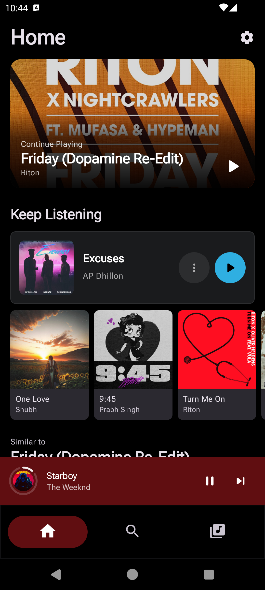
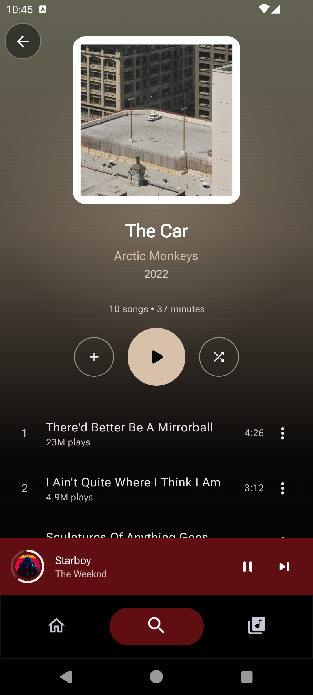
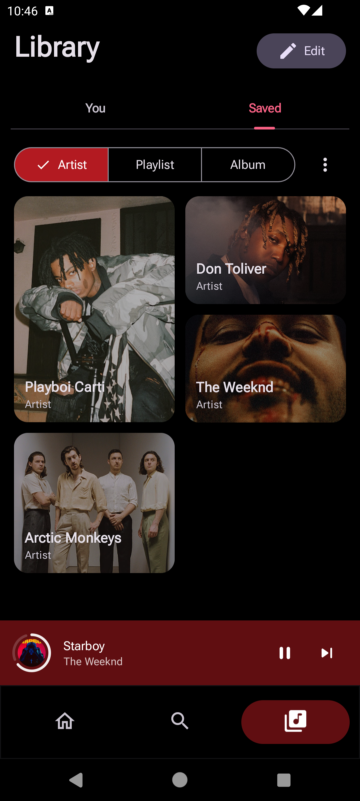
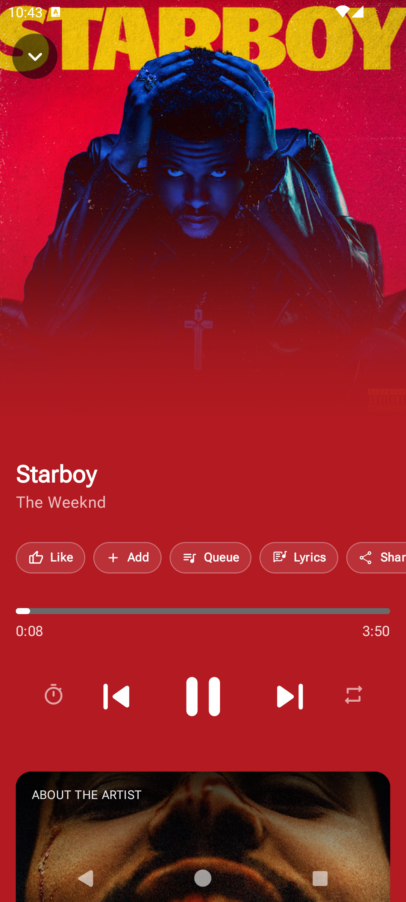
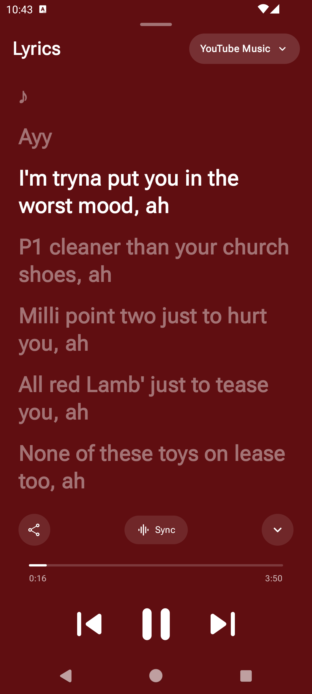
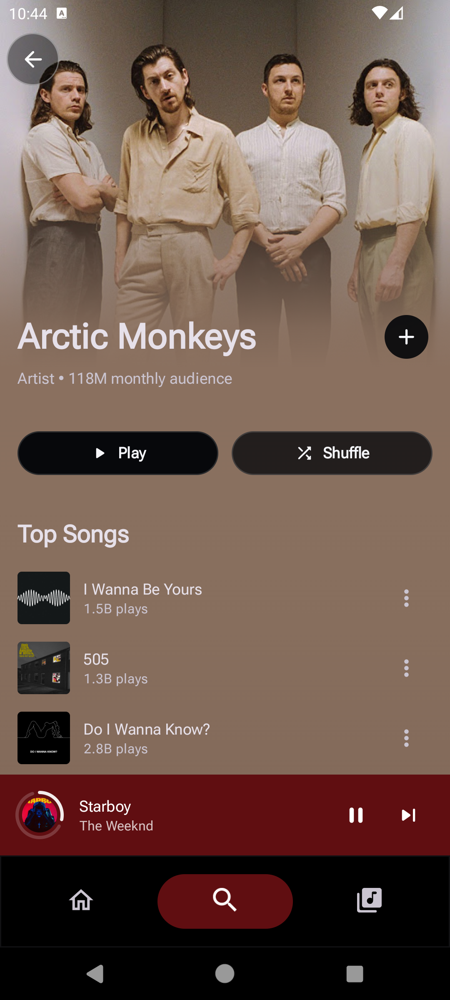

<div align="center">


# Musicality

A modern, feature-rich Android music player that brings millions of songs, albums, and playlists to your fingertips — beautifully.


<br/>

<a href="https://github.com/rishi0810/Musicality-App/releases/">
  
</a>

<br/><br/>

<p>
  
  
  
</p>
<p>
  
  
  
</p>

</div>

---

## What You Get

Musicality is built around the idea that your music experience should feel effortless. Stream, discover, and organize music with a clean interface and powerful playback engine — no compromises.

---

## Features

### Personalized Home Feed
- Curated recommendations tailored to your taste
- Quick picks and recently played content at a glance
- Jump straight to your favorite artists, albums, or playlists

### Search & Discovery
- Search across songs, artists, albums, and playlists instantly
- Browse by mood — *Feel Good*, *Focus*, *Energy*, and more
- Explore trending charts and top hits

### Your Library
- Access your liked songs, saved albums, and playlists in one place
- Full listening history so you never lose track of what you loved
- Offline access for saved content

### Playback Experience
- Full-screen player with album art, lyrics, and smooth controls
- **Crossfade** between tracks for seamless listening
- Repeat one, repeat all, or shuffle — your choice
- Background playback with lockscreen and notification controls
- Mini player always within reach while you browse

### Artist & Album Pages
- Deep-dive into any artist's discography and top tracks
- Full album views with track listings
- Similar artist suggestions to keep discovering

### More
- "Play Next" and "Add to Queue" from anywhere in the app
- Offline caching for faster load times
- Dynamic dark theme with colors pulled from album art

---

## Getting Started

### Requirements
- Android 10+ (API 29)
- Android Studio Hedgehog or newer

### Installation
1. **Download** the latest APK from the [Releases page](https://github.com/rishi0810/Musicality-App/releases/)
2. Enable **Install from Unknown Sources** on your device
3. Install and enjoy

> **For developers:** Clone the repo, open in Android Studio, and run on a device or emulator. Requires Android SDK 34+, Kotlin 1.9+, and Gradle 8+.

## Release Process

Releases are made from `main`. The release tag supplies the app version, and pushing a `v*` tag starts `.github/workflows/android-signed-release.yml`, which builds a signed APK and publishes a GitHub Release. GitHub Actions must have the Android signing secrets configured.

For each release:

1. Fetch the latest main branch and tags, then check the latest tag already pushed to GitHub:

   ```bash
   git fetch origin --tags
   git ls-remote --tags --refs origin 'v*' \
     | cut -f2 \
     | sed 's#refs/tags/##' \
     | sort -V \
     | tail -n1
   ```

2. Update the version badge above and run the checks:

   ```bash
   ./gradlew test :app:assembleDebug
   ```

3. Stage only the README and app source. Review the staged paths and diff to ensure unrelated files (screenshots, IDE settings, local configuration, and coding-agent files) are excluded:

   ```bash
   git add README.md app/src/main
   git diff --cached --check
   git diff --cached --stat
   git diff --cached --name-only
   ```

4. Commit and push the commit to `main`:

   ```bash
   git commit -m "Release vX.Y.Z"
   git push origin HEAD:main
   ```

5. Create and push an annotated version tag on that commit. Replace `vX.Y.Z` with the new version, and do not reuse a tag already present on origin:

   ```bash
   git tag -a vX.Y.Z -m "Release vX.Y.Z"
   git push origin vX.Y.Z
   ```

6. Confirm the tag is on GitHub and check the Actions run and published release:

   ```bash
   git ls-remote --tags origin 'refs/tags/vX.Y.Z' 'refs/tags/vX.Y.Z^{}'
   ```
